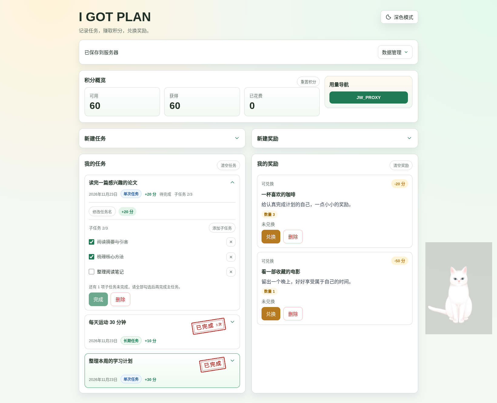

# I GOT PLAN

记录任务，赚取积分，兑换奖励。一个把日常计划、子任务清单和奖励兑换放在一起的个人看板，让每一次完成都有反馈。

## 界面预览

*使用示例任务与奖励展示。*

## 核心功能

- **任务管理**：支持单次任务和可反复完成的长期任务，按日期记录，自定义任务积分。
- **子任务清单**：将任务拆成具体步骤，逐项勾选并查看进度，全部完成后领取任务积分。
- **积分与奖励**：查看可用、获得和已花费积分，自定义奖励及库存，用积分兑换奖励。
- **完成反馈**：完成任务显示盖章动画，长期任务记录完成次数，兑换奖励播放庆祝动画。
- **数据保存**：自动保存到服务器，支持数据导入导出、旧记录迁移和未保存内容恢复。
- **界面与互动**：浅色与深色主题、可折叠的表单和任务卡片，以及会跟随鼠标、响应点击的 Live2D 白猫 Tororo。
